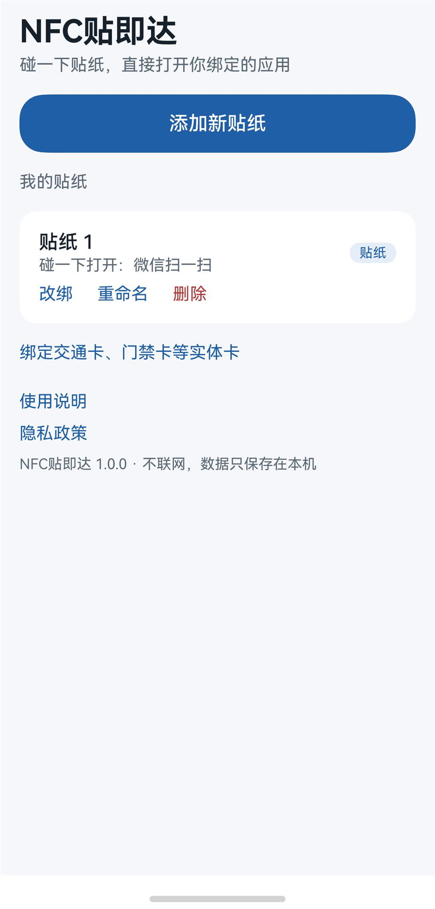
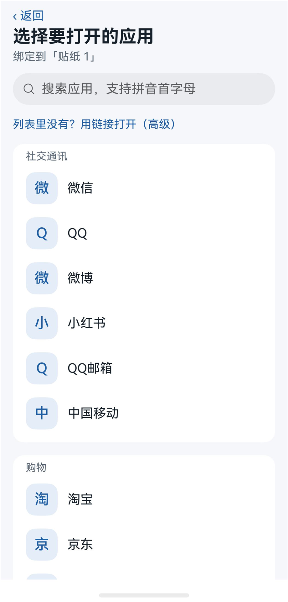

# NFC Tiejida (NFC贴即达)

Turn a cheap NFC sticker into a physical shortcut on HarmonyOS. Write a sticker once, bind it to an app, and from then on tapping the sticker with an unlocked phone opens that app directly — no need to open this app first, no notification, no app chooser.

  
  

- Native HarmonyOS app (ArkTS, Stage model), API 26 / HarmonyOS 7
- One sticker → one app; rebind any time without rewriting the sticker
- Built-in, searchable list of common apps (pinyin initials supported), plus custom links for anything else
- Physical cards (transit / access cards) can be bound too, with a system-imposed extra tap (see below)
- No network permission, no server, no data collection: bindings are stored on the device only
- The only permission is `ohos.permission.NFC_TAG`

Available on Huawei AppGallery (China mainland) as **NFC贴即达**. The UI is in Chinese.

## How it works

A blank NTAG213/215 sticker is written with two NDEF records:

1. a URI record `nfclauncher://tag/<8 hex id>`, which identifies the sticker;
2. an OpenHarmony application record (`ohos.com:pkg` = this app's bundle name, via `tag.ndef.makeApplicationRecord`).

When the phone reads a tag that carries an application record, the system NFC service starts that app's entry ability directly (`DispatchByHarBundleName`) and passes the URI in the Want. The app looks up the binding for that sticker id and launches the target app with an explicit Want or `openLink`. Measured on a Pura 90 Pro: about 0.3 s from tap to the target app in the foreground.

Physical cards without NDEF content behave differently: the system first posts an "NFC service" notification that must be tapped, then shows an app chooser. That is how the system dispatcher is designed and cannot be skipped with public APIs, so stickers are the recommended path.

Other platform facts discovered along the way are in [docs/HOW-IT-WORKS.md](docs/HOW-IT-WORKS.md).

## Project layout

| Path | Contents |
|---|---|
| `app/` | DevEco Studio project (ArkTS source, resources) |
| `app/entry/src/main/ets/common/` | Storage, launching, sticker writing, the built-in app catalog |
| `app/entry/src/main/ets/pages/` | Home, app picker, NFC launch page, feedback, privacy policy |
| `scripts/` | PowerShell build / device helpers used during development |
| `tools/make_icons.py` | Generates the app icon |
| `docs/store/` | Icon and store screenshots |

## Building

Open `app/` in DevEco Studio (26.x, HarmonyOS SDK API 26), let it generate a debug signature (File → Project Structure → Signing Configs → Automatically generate signature) and run on a device with NFC.

The scripts in `scripts/` were written for the author's machine and contain absolute paths (DevEco install location, an ASCII-only build copy because Hvigor rejects non-ASCII project paths). Adjust the paths at the top of each script before using them.

**If you publish your own build**, change the bundle name in `app/AppScope/app.json5` and the `BUNDLE` constant in `app/entry/src/main/ets/common/Sticker.ets` — they must match, because the bundle name is written onto every sticker. Also replace the developer name and contact in `common/AppInfo.ets`.

## Adding apps to the catalog

Third-party apps cannot list installed apps on HarmonyOS (`GET_INSTALLED_BUNDLE_LIST` is reserved for system apps), so the picker uses a hand-maintained catalog of bundle name + entry ability pairs in `common/AppCatalog.ets`. Entries were read from a real device with `bm dump` (see `scripts/Collect-Apps.ps1`). Pull requests with verified entries are welcome.

## License

[MIT](LICENSE)
